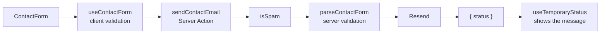

# Digital Portfolio

[](https://github.com/maximsukhetsky/digital-portfolio/actions/workflows/ci.yml)

Personal portfolio of **Maxim Sukhetsky**, Frontend Engineer based in Kyiv.

**Live:** <LIVE_URL>

## Tech Stack

- **Next.js 16** (App Router, Server Components, Server Actions, typed routes)
- **React 19** and **TypeScript**
- **SCSS Modules** with shared tokens and mixins
- **Prettier** with automatic import sorting
- **Resend** for contact form emails
- **GitHub Actions** CI, deployed on **Vercel**

## Features

- **Pages:** Home, About, Experience, Education and a custom 404 page with a pointer-driven spotlight effect.
- **Content:** featured projects with live demos (and source code for non-commercial ones), work history, LinkedIn recommendations, and scanned diplomas and certificates that open the original or its verification page.
- **Contact form** in the footer of every page, sent through a Server Action.
- **Mobile-first, responsive layout** with tablet and desktop breakpoints: two-column sections, timeline rows for experience and education, card grids for courses and recommendations, and an animated full-screen mobile menu.
- **Accessibility:** semantic markup, `aria-current` navigation, accessible form errors, focus on the first invalid field, `prefers-reduced-motion` support, hover styles only on devices with a cursor.
- **Performance:** Server Components by default, client code only where interaction requires it, `next/image` with blur placeholders, `next/font` with fallback metrics to limit CLS.

## Architecture Highlights

### Project structure

```
src/
├── app/            # Routes only; pages live in the (site) route group
├── components/
│   ├── layout/     # Site chrome: header, footer with the contact form
│   ├── pages/      # Sections owned by a single page (home, about, ...)
│   └── ui/         # Reusable primitives: Button, Input, FormField, ...
├── constants/      # Shared constants and SVG icons
├── lib/            # Non-React logic and content data
└── styles/         # tokens/, mixins/, base/ and the globals.scss entry point
```

Child components are nested inside their owner's directory, and each component keeps its styles next to it.

### Contact form



- **Shared validation:** one schema (`src/lib/contact-form/schema.ts`) is used on the client for instant feedback and again on the server before sending.
- **No form library:** state, validation and focus handling are implemented in a small `useContactForm` hook. Submission runs in `useTransition`.
- **Spam protection:** a hidden honeypot field plus a minimum fill time. Detected spam gets a fake success response and no email is sent.

### Layout vs template

The header lives in `(site)/layout.tsx` and persists across navigation. The footer with the contact form lives in `(site)/template.tsx`, so it remounts on every route change and the form state resets. The 404 page sits outside the route group and has neither.

### Styles

- Mobile-first breakpoints via a `bp.from(tablet | desktop)` mixin that fails the build on unknown names.
- A `t.text()` typography mixin that converts `px` line-heights to unitless ratios.
- The CSS reset sits in `@layer reset`, so component styles always win regardless of import order.

## Quality

Every push and pull request to `main` runs CI:

1. ESLint
2. Prettier format check
3. TypeScript type check (after `next typegen`, which generates the typed route definitions in `.next/types` on a clean checkout)
4. Production build
5. Smoke tests against the running production server (`scripts/smoke.test.mjs`): page titles, metadata, active navigation, static assets and the 404 status.

The smoke tests run against `http://localhost:3000` by default. Set `SMOKE_URL` to check any other deployment, e.g. a Vercel preview:

```bash
SMOKE_URL=https://<preview-url> pnpm run smoke
```

The project uses Conventional Commits, and all changes go through pull requests.

## Getting Started

Requirements: Node.js 24 (see `.nvmrc`) and pnpm 11.

```bash
pnpm install
cp .env.example .env   # add your RESEND_API_KEY
pnpm dev                     # http://localhost:3000
```

| Command                 | Description                                     |
| ----------------------- | ----------------------------------------------- |
| `pnpm dev`              | Start the dev server                            |
| `pnpm build`            | Production build                                |
| `pnpm start`            | Serve the production build                      |
| `pnpm run lint`         | Run ESLint                                      |
| `pnpm run typecheck`    | Run the TypeScript type check                   |
| `pnpm run format`       | Format all files with Prettier and sort imports |
| `pnpm run format:check` | Check formatting without writing                |
| `pnpm run smoke`        | Run smoke tests against a running server        |

### Environment variables

| Variable         | Description                                                                    |
| ---------------- | ------------------------------------------------------------------------------ |
| `RESEND_API_KEY` | API key for [Resend](https://resend.com), required to send contact form emails |

## Deployment

The site is deployed on **Vercel** through its GitHub integration:

- every push to `main` triggers a production deployment;
- every pull request gets its own preview deployment;
- `RESEND_API_KEY` is set in the Vercel project's environment variables.

## Credits

The design is based on the **Portfolio for Developers** Figma Community template, extended with a tablet layout and the pages it does not cover.

## License

© Maxim Sukhetsky. All rights reserved. The code is public for review; the personal content, photos and documents may not be reused.
